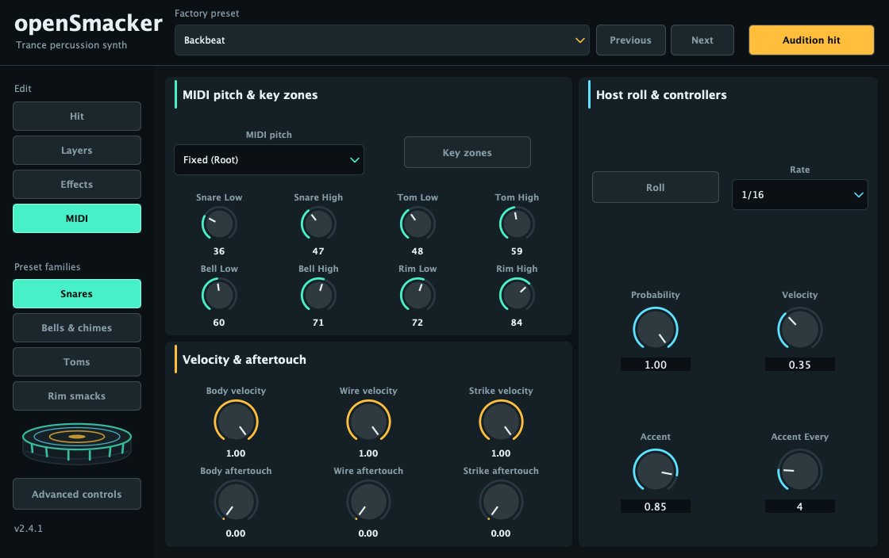

# openSmacker v2.2.2

[Install with OpenVST Manager](https://github.com/alanmarcero/alan-m-OpenVSTManager/releases/latest)

openSmacker makes pitched trance percussion. Choose Dance Snare, Club Tom-Tom, FM Bell / Chime, or Pryda / Rim Smack. Play each hit from MIDI or use the built-in audition controls.

## Screenshots

## Shape each hit

Set the root note, octave, and cents. Use fixed pitch or track MIDI notes, and lock the pitch when you want a voice to stay tuned. The default hit is a one-shot. Enable **Full ADSR** to hold a sound until the matching MIDI note and channel end; set release up to 20 seconds.

Add one to five pre-strikes with adjustable spread, decay, humanization, pan, and level. Choose Stick, Mallet, Rimshot, or Laser for the transient. Add Snare Wires, White Sizzle, Velvet Air, or Metallic Ring. Each layer has its own envelope, filters, level, and width. Set wire tension to change the snare-wire sound. Body and transient have separate filters and pan controls.

Choose Tape, Tube, Hard Clip, or Wavefold saturation. Add compression, limiting, gated reverb, reverse swell, stereo width, and output gain. Use the animated stage or **Push It** to audition. Lock a rendered hit as a WAV for repeatable playback; the lock saves with the project.

## Presets and controls

The factory bank has 72 presets: 24 snares, 24 bells and chimes, and 24 toms. Browse by voice category, preset menu, or previous and next controls. Lock any of the six sound sections to keep its values while browsing; locked controls remain editable. The editor has Hit, Layers, Effects, and MIDI pages, each with Simple and Advanced views.

## Play with MIDI

MIDI notes trigger hits, and velocity changes their level. Turn on key zones to map notes 36–47 to Dance Snare, 48–59 to Club Tom-Tom, 60–71 to FM Bell / Chime, and 72–84 to Pryda / Rim Smack. Set layer velocity and aftertouch response. Use host-synced rolls at eighth, sixteenth, or thirty-second notes, with adjustable probability and accent.

Assign MIDI CCs to the body, wire, and transient layers. CC 7 controls output level, CC 74 controls the air filter, CC 120 and 123 stop sound, and CC 121 resets controllers. Three stereo outputs provide separate dry Body, Wires, and Transient signals.

## Formats and license

VST3, LV2, and Standalone formats are available on macOS, Windows, and Linux. AU is available on macOS.

MIT License. See [LICENSE](LICENSE).
