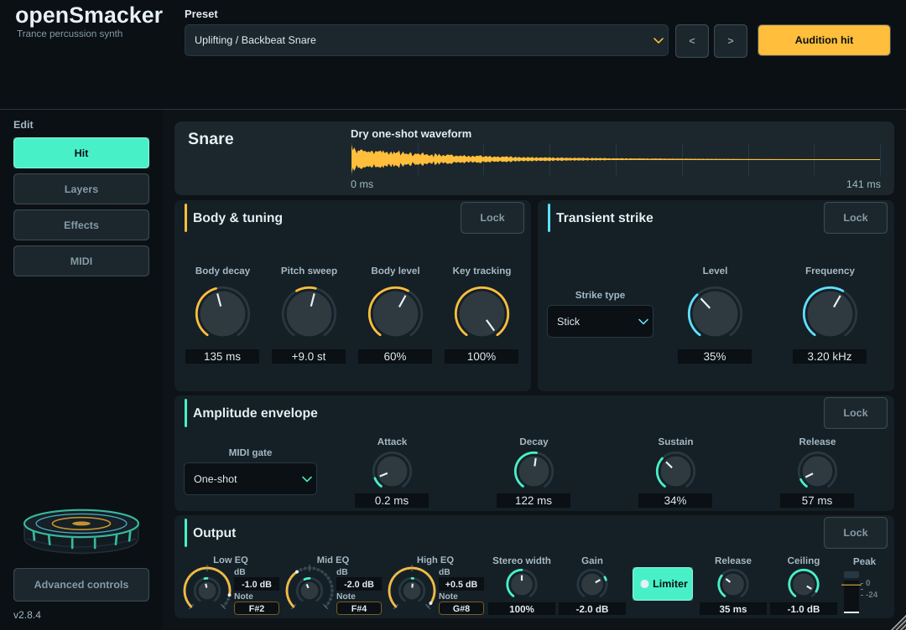

# openSmacker v2.7.0

[Install with OpenVST Manager](https://github.com/alanmarcero/alan-m-OpenVSTManager/releases/latest)

## Beta

All of these plugins are in beta. The macOS and Linux builds are not up to date, so the Windows build is the one to use for now. A plugin can change dramatically from one release to the next, but the goal is for each one to keep getting better.

openSmacker synthesizes pitched trance percussion. Play a short backbeat, tune a tom fill to your bass line, or hold a metallic note from a MIDI keyboard.

## Find a sound

The **Preset** menu organizes 56 factory presets into six dance styles: 16 Uplifting and 8 each of Rolling, Progressive, Psy, Tech, and Classic. Each preset is one voice: snare, tom, bell, or rim. The menu shows the name of the loaded preset, factory or your own, and adds * after you edit it. **Previous**, **Next**, and **Audition hit** work on every page.

Try *Backbeat* for a snare with tight wires, *Glass Pin* for a chime, *Floor Pocket* for a low tom, or *Dry Tap* for a short side accent. Snares and rim shots fall off into noise. Bells and toms keep a pitch. Harder strikes produce a brighter attack. Factory hits sit under the output limiter. The **Hit** page shows a preview of the dry one-shot. The illustrated drumhead in the sidebar pulses on the host beat, rests when playback stops, and runs on an internal clock in Standalone.

## Play one-shots or held notes

The factory sounds start in **One-shot**. Use **Body decay**, **Pitch sweep**, and the strike **Level** to fit the hit to your rhythm. On the **Layers** page, set the number and spacing of flam strikes, or adjust the wire texture, level and decay.

Choose **Hold notes** under **MIDI gate** on the Hit page to sustain the voice from a keyboard. **Attack**, **Decay**, **Sustain**, and **Release** are editable in both views. A matching note-off on the same MIDI channel starts the release, which can run up to 20 seconds. The struck FM overtones fade while the body continues to sound. **Audition hit** and the host roll play one-shots.

**Key tracking** on the Hit page moves the pitch with the MIDI note. At 0% every note plays A4. Set the velocity or aftertouch response separately for the body, wires, and transient.

## Shape and route the layers

Enable **Advanced controls** for the transient filters, wire attack and hold, and flam humanization. In this view the **Layers** page adds a **Body detail** card with shell resonance, pitch decay, and the body filters. A control that has no effect in the current state, such as flam spacing with one hit, draws dimmed but stays editable, and its tooltip says what turns it on. On/off buttons show a light. Each card's **Lock** keeps that card's values when you load a preset, and locked controls stay editable.

The **Hit** page includes the **Output** strip (dual-layer 3-band EQ with ±12 dB gain and note-snapped frequency selection across two octaves per band, stereo width, output gain, brickwall limiter, and a peak meter in dBFS) alongside body tuning, transient strike, and amplitude envelope. The meter's line holds the highest peak for a second, and its top light stays on after a peak above 0 dBFS until you click it.

On **Effects**, choose Tape, Tube, Hard Clip, or Wavefold saturation. Advanced controls include compression, gated reverb, a tempo-synced reverse swell, and **Freeze hit**, which stores a rendered hit in the project and plays it in place of the synth. While a hit is frozen, the Hit page draws that hit with an **Unfreeze** button, and the controls it bypasses draw dimmed. **Drag WAV** pulls the frozen hit out of the plugin as a WAV file. With no frozen hit, it renders a fresh one. Three additional stereo output buses carry the dry body, wires, and transient.

The window keeps its aspect ratio and scales from 70% to 200% of the design size. The project remembers the size. **Undo** and **Redo** step through parameter edits, including Cmd/Ctrl+Z and Shift+Cmd/Ctrl+Z. **A** and **B** keep two copies of the sound; **A to B** and **B to A** copy between them. **Presets** opens the factory bank and your own sounds inside the editor, with search and favorites. Save, rename, and delete write user presets to Documents/Alan Marcero/openSmacker/Presets. Before Save replaces a preset with the same name, or Delete removes one, the button asks again; click it a second time within three seconds to confirm. Factory presets stay read-only.

The roll note shows a note name and accepts a typed name such as C#4. Its **Learn** takes the next note. A second click, Escape, or ten seconds without input cancels **Learn**. Use host-synced eighth-, sixteenth-, or thirty-second-note rolls and adjust their probability, velocity, and accent. Assign a CC to each layer by typing its number or with **Learn**, which takes the next controller the plugin receives. **Off** turns a slot off. CC 7 controls output, CC 74 controls the air filter, CC 120 and 123 stop sound, and CC 121 resets controllers.

## Formats and license

VST3, LV2, and Standalone are available on macOS, Windows, and Linux. AU is available on macOS. Earlier projects open as **Custom sound** with their saved parameters, original synthesis, section locks and embedded audio. Selecting a new factory program loads the new sound.

AGPL-3.0. See [LICENSE](LICENSE).
