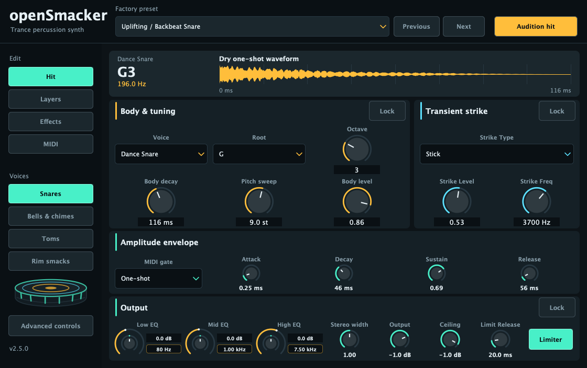

# openSmacker v2.2.1

<p align="center">
  <strong>Trance percussion, tuned for impact.</strong><br>
  A real-time snare, bell, and tom synthesizer for progressive, uplifting, tech, and psy trance.
</p>

<p align="center">
  
</p>

<p align="center">
  
</p>

<p align="center">
  
</p>

<p align="center">
  
</p>

openSmacker is a C++20 instrument built with JUCE 8. Version 2 replaces the sound engine, effects, preset catalog, and editor while keeping the previous voice types, synthesis controls, MIDI mappings, program navigation, lock-in WAV workflow, and plugin formats. Its new envelopes and multi-part drum and metallic voices keep the transient and tuned body audible together for a more forceful dance and trance hit.

Version 2.1 adds separate performance gains and stereo output buses for the body, wires, and transient. Version 2.2 adds independent body/transient filters, per-layer pan, and wire tension. Full ADSR is MIDI-note tracked, preserves its release tail through Lock-In playback, and uses sample-accurate note-off handling.

## Sound design

- Four voices: Dance Snare, Club Tom-Tom, FM Bell / Chime, and Pryda / Rim Smack.
- Filter the tuned body and transient independently with host-automatable high/low-pass cutoffs. Each of the body, wire, and transient layers has its own host-automatable pan control.
- Adjust the snare-wire tension to change the resonant feedback and spectral brightness of the wire layer.
- Tune every voice by root note, octave, and cents; use fixed pitch or MIDI note tracking, and retain the separate Lock Pitch option.
- Optional Full ADSR is off by default. When enabled, MIDI note-off releases the body, wires, and transient on the matching note/channel; release reaches 20 seconds and feeds the shared effects. Existing one-shot playback stays the default.
- Shape one to five pre-strikes with spread, decay, humanization, stereo pan, and level.
- Choose Stick, Mallet, Rimshot, or Laser transients. The transient and tuned body each have separate host-automatable high/low-pass filters and pan controls. Add Snare Wires, White Sizzle, Velvet Air, or Metallic Ring with attack, hold, decay, curve, high/low-pass filters, level, and stereo width; snare-wire tension and pan are independent controls.
- Process hits with Tape, Tube, Hard Clip, or Wavefold saturation; compressor; brickwall limiter; gated trance-hall reverb; host-synced reverse swell; master width; and output gain.
- Use the animated stage and Push It audition button. Lock a rendered hit as WAV for repeatable playback; the cache retains all four mapped voices and their layer stems, restores with the session, and adapts to the host sample rate.

## Section locks

Each of the six sections has a lock button. When locked, a preset change preserves that section's values. Controls remain editable, and the lock state is stored with the session. Lock Pitch and Lock WAV remain separate features.

## New factory presets

The factory bank contains 72 new presets: 24 snares (`SN`), 24 bells and chimes (`BL`), and 24 toms (`TM`). Every preset sets all of its sound and effect values. The old factory names and definitions have been retired. Browse with the category shortcuts, preset menu, or previous/next buttons.

**Snares:** SN 01 Skyline Gate · SN 02 Neon Signal · SN 03 Aurora Snap · SN 04 Glass Horizon · SN 05 Afterglow Crack · SN 06 Silver Meridian · SN 07 Pulse Cathedral · SN 08 Voltage Bloom · SN 09 Starlight Rim · SN 10 Celestial Wire · SN 11 Chrome Lift · SN 12 Radiant Break · SN 13 Prism Impact · SN 14 Night Drive Clap · SN 15 Solar Flare · SN 16 Crystal Rush · SN 17 Echo Chamber · SN 18 Blue Hour Strike · SN 19 Harmonic Flash · SN 20 Skyline Roll · SN 21 Luminous Drop · SN 22 Electric Ribbon · SN 23 Summit Hit · SN 24 Last Light.

**Bells and chimes:** BL 01 Glass Comet · BL 02 Polar Bloom · BL 03 Silver Orbit · BL 04 Prism Arp · BL 05 Dawn Sequence · BL 06 Strobe Chime · BL 07 Moonlit Carrier · BL 08 Radiant Shard · BL 09 Crystal Current · BL 10 Aurora Bell · BL 11 Halo Cascade · BL 12 Skyline Tines · BL 13 Meteoric FM · BL 14 Velvet Beacon · BL 15 Electric Halo · BL 16 Blue Planet · BL 17 Frozen Spark · BL 18 Ascension Tone · BL 19 Neon Harmonic · BL 20 Starfield Chime · BL 21 Lucid Sequence · BL 22 Diamond Signal · BL 23 Solar Glass · BL 24 Afterlight Bell.

**Toms:** TM 01 Uplift Driver · TM 02 Deep Meridian · TM 03 Stadium Roll · TM 04 Orbital Tension · TM 05 Pulse Foundry · TM 06 Horizon Runner · TM 07 Neon Floor Tom · TM 08 Eventide Rise · TM 09 Subsurface Bloom · TM 10 Chrome Tension · TM 11 Festival Engine · TM 12 Nightfall Tom · TM 13 Solar Sequence · TM 14 Pressure Valve · TM 15 Aurora Rack · TM 16 Voltage Runner · TM 17 Cathedral Floor · TM 18 Low Orbit · TM 19 Starlane Roll · TM 20 Impact Vector · TM 21 Glass Mountain · TM 22 Breakpoint Tom · TM 23 Lightwell Rack · TM 24 Final Ascent.

## Editor

The redesigned editor is 1100 × 972 with four pages:

- **Hit:** voice, tuning, ADSR, transient, and animated stage.
- **Layers:** pre-strikes, snare wires, sizzle, and air.
- **FX:** saturation, dynamics, reverb, reverse sync, MIDI mode, output, and WAV lock.
- **MIDI:** four voice key zones, layer velocity and aftertouch, host-synced rolls, and assignable layer CCs.

Simple and Advanced views are retained. Simple removes numeric boxes for a clearer surface; Advanced adds exact value readouts. Every parameter remains on its page and editable in both views. Screenshots are in [docs/SCREENSHOTS.md](docs/SCREENSHOTS.md).

## MIDI and state

Note-on messages trigger hits on every MIDI channel and velocity controls the hit level. With Full ADSR enabled, sample-accurate note-off releases only the matching MIDI note and channel; note-off is ignored by the default one-shot mode. The optional key zones map notes 36–47 to Dance Snare, 48–59 to Club Tom-Tom, 60–71 to FM Bell, and 72–84 to Pryda / Rim Smack; notes outside the configured zones are ignored while zones are enabled. Fixed Root and Note Tracking remain available for the body, tuned metallic noise, strike, and pitch sweep.

Body, wire, and transient velocity depth and aftertouch are independent. Enable the host-synced roll to retrigger at 1/8, 1/16, or 1/32-note intervals while transport plays; set its probability and accent velocity. Body, wire, and transient MIDI CCs are assignable (default CC 20, 21, and 22; CC 0 disables a mapping). The existing CC 7 output level, CC 74 air low-pass, CC 120/123 silence, and CC 121 reset behavior remains.

The Body, Wires, and Transient stereo output buses provide dry component stems before saturation, compression, limiter, and reverb. They follow the layer velocity, aftertouch, and assigned CC controls, including during Lock-In playback. Each key zone selects its own cached voice. Existing stereo locked-WAV session data still loads as one shared sound; generated Lock-In banks save all four voices and stems. Existing parameter IDs, program count, and plugin identity are preserved. Missing section-lock data in older sessions opens unlocked.

## Formats

VST3, AU (macOS), LV2, and Standalone are built from the same source.

## Build

```sh
cmake -B build -DCMAKE_BUILD_TYPE=Release
cmake --build build --config Release --parallel
ctest --test-dir build --output-on-failure
```

See [docs/AUDIO.md](docs/AUDIO.md) for synthesis and effect notes. The project is licensed under GPL-3.0; see [LICENSE](LICENSE).
