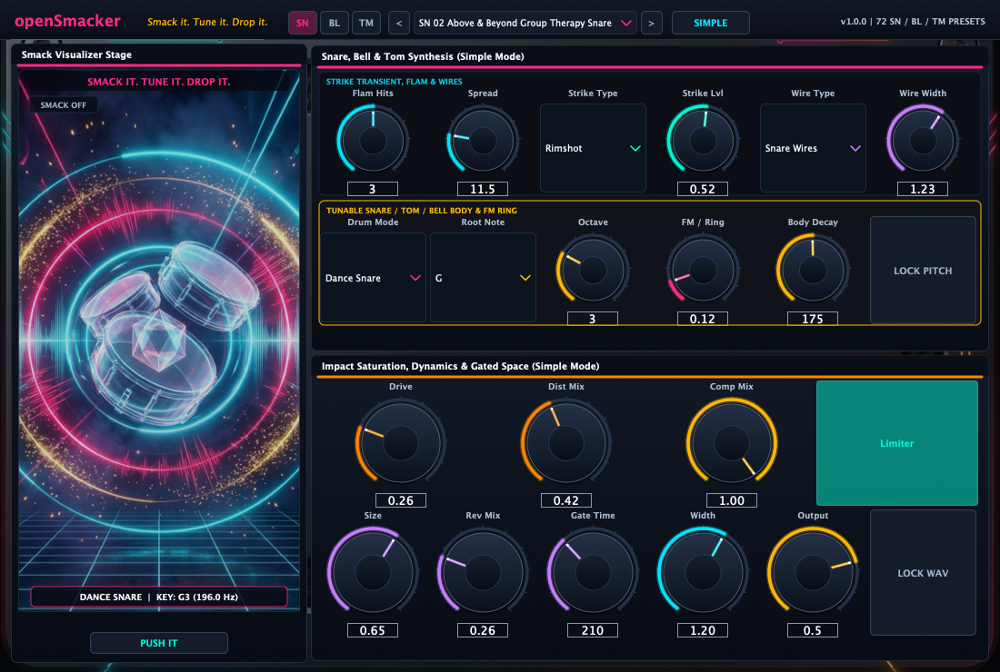
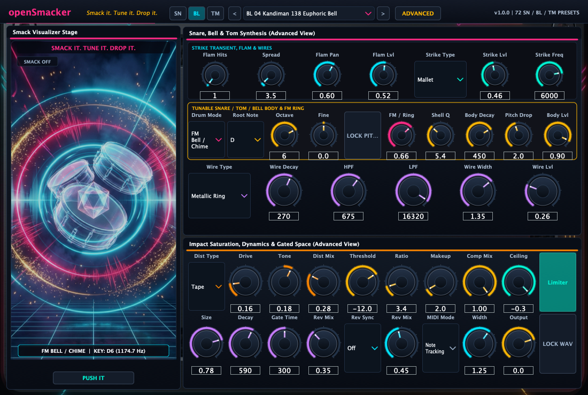

# openSmacker

<p align="center">
  <strong>Smack it. Tune it. Drop it.</strong><br>
  Open-source tunable dance snare, FM bell, and club tom-tom synthesizer plugin for EDM and underground trance.
</p>

<p align="center">
  
</p>

<p align="center">
  
</p>

## Overview

`openSmacker` is a real-time C++20 and JUCE 8 percussion synthesizer built for electronic dance music, progressive trance, uplifting 138 trance, and melodic club production. Rather than relying on static sample packs, `openSmacker` synthesizes every hit from four independent physical and FM voice engines paired with a stereo mastering chain.

Producers can tune the drum or bell body to the exact musical key of their track (`C` through `B` across octaves `1` to `8`, plus fine cents), lock the pitch while browsing presets (`LOCK PITCH`), or freeze the random seed (`LOCK IN (WAV)`) so every hit renders identically when bouncing stems.

## Synthesis Architecture

1. `VOICE ENGINE` provides four synthesis modes:
   - `Dance Snare`: Dual-membrane modal resonator with pitch-env sweep and harmonic shell excitation.
   - `Club Tom-Tom`: Deep fundamental pitch-sweep oscillator with sub-harmonic punch and mallet resonance.
   - `FM Bell / Chime`: 2-operator metallic FM synthesis with inharmonic ratios for crystalline chimes, bells, and ride pings.
   - `Pryda / Rim Smack`: High-tension rimshot and arena snare generator built for big-room transitions.
2. `PRE-STRIKE FLAM / DRAG ROLL` schedules 1 to 5 micro-bursts before the main transient with independent spread, decay, timing humanization, and stereo pan width.
3. `SNARE WIRES, SIZZLE & AIR` offers four stereo noise colors (`Snare Wires`, `White Sizzle`, `Velvet Air`, `Metallic Ring`) with dedicated attack, hold, decay, curve, HPF/LPF filters, and stereo width.
4. `STICK / MALLET / RIM TRANSIENT` shapes the initial impact (`Stick`, `Mallet`, `Rimshot`, `Laser`) with tunable center frequency.
5. `MASTER FX CHAIN` includes four-mode saturation (`Tape`, `Tube`, `Hard Clip`, `Wavefold`), punch compression, brickwall limiting, gated trance hall reverb, and host-synced pre-hit reverse swell (`Beat End`, `Beat 4 Auto`, `1/2 Beat`, `1/4 Beat`).

## 72 Factory Presets (24 SN + 24 BL + 24 TM)

`openSmacker` ships with 72 presets organized into three categories (`SN` for Snares, `BL` for Bells, and `TM` for Tom-Toms), with quick category jump buttons (`SN` / `BL` / `TM`) in the top bar:

### Snares (`SN 01` - `SN 24`)

| # | Preset Name | Style |
|---|---|---|
| 01 | `SN 01 Anjuna Snare Smack` | Anjunabeats progressive snare with crisp wire tail |
| 02 | `SN 02 Above & Beyond Group Therapy Snare` | Wide melodic trance snare with stereo flam |
| 03 | `SN 03 Pryda Arena Rim Smack` | Huge gated arena rim-snare for progressive drops |
| 04 | `SN 04 Bayer Analog Tight Snare` | Punchy analog progressive snare |
| 05 | `SN 05 Bluestone Snap Rim Snare` | High-tension rimshot snare with tight gated tail |
| 06 | `SN 06 Myon & Shane 54 Summer Snare` | Bright summer progressive house snare |
| 07 | `SN 07 Sun & Moon Push the Button Snare` | Emotional anthem snare with wide hall tail |
| 08 | `SN 08 Zo Funk Electro Snare` | Gritty electro-trance snare with laser transient |
| 09 | `SN 09 Daniel Kandi Always Alive Snare` | Uplifting 138 snare with airy high-end sizzle |
| 10 | `SN 10 Sean Tyas Degenerate Punch Snare` | Hard-hitting tech-trance snare |
| 11 | `SN 11 Ferry Corsten Flashover Electro Snare` | Driven Dutch electro-trance snare |
| 12 | `SN 12 System F Out of the Blue 909 Snare` | Classic 1999 Dutch uplifting 909 snare |
| 13 | `SN 13 Armada Mainstage Snare` | Big-room festival trance snare |
| 14 | `SN 14 ASOT 138 Uplifting Snare` | Bright uplifting trance snare |
| 15 | `SN 15 Subculture Tech-Trance Snare` | Punchy underground tech-trance snare |
| 16 | `SN 16 Coldharbour Dark Rim Smack` | Dark progressive rimshot snare |
| 17 | `SN 17 FSOE 140 Anthem Snare` | High-energy 140 BPM uplifting snare with 4-hit flam |
| 18 | `SN 18 Vandit Berlin Club Snare` | Tight Berlin club trance snare |
| 19 | `SN 19 Garuda Big Room Snare` | Compressed UK club snare |
| 20 | `SN 20 Wake Your Mind Snare` | Modern progressive trance snare |
| 21 | `SN 21 Euphonic Uplifting Snare` | Warm melodic trance snare |
| 22 | `SN 22 Positiva 99 Ibiza Snare` | Late-90s Ibiza anthem snare |
| 23 | `SN 23 Note-Tracked Melodic Snare Roll` | Keyboard-tracked snare for pitched build-up rolls |
| 24 | `SN 24 Clean Studio Reference Snare` | Dry, uncolored reference dance snare |

### FM Bells & Chimes (`BL 01` - `BL 24`)

| # | Preset Name | Style |
|---|---|---|
| 25 | `BL 01 Tri-State Crystal Bell` | Crystalline FM chime for atmospheric trance breakdowns |
| 26 | `BL 02 OceanLab Balearic Chime` | Shimmering Balearic high-octave bell |
| 27 | `BL 03 Anjunadeep Glass Bell` | Warm deep-house glass mallet bell |
| 28 | `BL 04 Kandiman 138 Euphoric Bell` | Bright uplifting melodic bell lead/accent |
| 29 | `BL 05 Venice Beach Sunset Chime` | Lush stereo sunset chime |
| 30 | `BL 06 Childish Gambit FM Bell` | Punchy metallic FM bell hit |
| 31 | `BL 07 Lift High Acid Bell` | Resonant wavefolded acid bell |
| 32 | `BL 08 Tytanium Metallic Cowbell` | Tech-trance tuned cowbell |
| 33 | `BL 09 Gouryella Heaven Bell` | Expansive hall chime for euphoric breakdowns |
| 34 | `BL 10 Punk Metallic Bell Smack` | Gritty distorted electro bell |
| 35 | `BL 11 Kyoto Ritual Bell` | Deep temple FM bell |
| 36 | `BL 12 Who's Afraid 138 Ride Bell` | High-frequency metallic ride bell ping |
| 37 | `BL 13 Black Hole Cosmic Bell` | Wide cosmic trance bell |
| 38 | `BL 14 Bonzai Rave Cowbell` | Classic rave metallic cowbell |
| 39 | `BL 15 Aalto Pluck Bell` | Finnish progressive pluck bell |
| 40 | `BL 16 Solaris Shimmer Bell` | Airy Balearic shimmer bell |
| 41 | `BL 17 Enhanced Progressive Chime` | Clean melodic progressive bell |
| 42 | `BL 18 Mau5 Pluck Bell Ping` | Tight deadmau5-style pluck bell |
| 43 | `BL 19 Silk Music Sunset Bell` | Soft organic progressive chime |
| 44 | `BL 20 Goa 909 Ride Bell` | Classic Goa trance ride bell |
| 45 | `BL 21 Berlin Industrial Anvil Bell` | Heavy industrial metallic anvil strike |
| 46 | `BL 22 Café del Mar Harmonic Chime` | Ambient Ibiza chillout chime |
| 47 | `BL 23 Melodic Keyboard FM Bell` | Pure note-tracked FM bell for playing melodies |
| 48 | `BL 24 Beat End Reverse Bell` | Host-synced reverse bell swell into the bar |

### Tom-Toms (`TM 01` - `TM 24`)

| # | Preset Name | Style |
|---|---|---|
| 49 | `TM 01 Anjunabeats Groove Tom` | Deep tuned progressive groove tom |
| 50 | `TM 02 Kandi Melodic Tom Fill` | Pitched melodic tom for uplifting transitions |
| 51 | `TM 03 Sean Tyas Psy-Tech Laser Tom` | Fast pitch-drop psy-trance zapper tom |
| 52 | `TM 04 Rotterdam Stadium Floor Tom` | Massive Dutch stadium floor tom |
| 53 | `TM 05 Coldharbour Deep Rolling Tom` | Dark rolling sub-groove tom |
| 54 | `TM 06 Aly & Fila Cairo Tribal Tom` | Punchy tribal percussion tom |
| 55 | `TM 07 High Contrast Tribal Tom` | High-impact stadium tribal tom |
| 56 | `TM 08 Gatecrasher 2000 Synth Tom` | Classic Y2K Sheffield trance synth tom |
| 57 | `TM 09 Anjunadeep Warm Percussive Tom` | Organic deep-house mallet tom |
| 58 | `TM 10 Prydz Muranyi Electro Tom` | Tight punchy progressive house electro tom |
| 59 | `TM 11 Ferry Corsten Rock Your Body Tom` | Electro-house synth tom |
| 60 | `TM 12 Simmons 80s Trance Synth Tom` | Classic hexagonal electronic synth tom |
| 61 | `TM 13 Subculture 140 Rolling Bass Tom` | Low-octave rolling tech-trance bass tom |
| 62 | `TM 14 Above & Beyond Red Rocks Canyon Tom` | Wide canyon-reverb stadium tom |
| 63 | `TM 15 Armada Progressive Groove Tom` | Clean club groove tom |
| 64 | `TM 16 Vandit Paul's Octapad Tom` | Live electronic pad tom |
| 65 | `TM 17 Astrix & Tyas Psy Zapper Tom` | High-sweep psychedelic laser tom |
| 66 | `TM 18 Gouryella Ligaya High Melodic Tom` | High-tuned Dutch trance melodic tom |
| 67 | `TM 19 Mau5 Progressive Tight Tom` | Dry minimal progressive tom |
| 68 | `TM 20 Ibiza Terrace Bongo-Tom` | High-pitched terrace percussion bongo-tom |
| 69 | `TM 21 Sub-Bass 808 Boom Tom` | Long sub-bass 808 drop tom |
| 70 | `TM 22 Ilan Bluestone Big Flam Tom` | Dramatic flam-roll stadium tom |
| 71 | `TM 23 Note-Tracked Keyboard Tom Rack` | Chromatic keyboard-tracked tom rack |
| 72 | `TM 24 Beat 4 Reverse Tom Pickup` | Host-synced Beat 4 reverse tom pickup |

## Formats

- `VST3`
- `AU` (macOS Audio Unit)
- `LV2`
- `Standalone` application

## Building from Source

```bash
cmake -B build -DCMAKE_BUILD_TYPE=Release
cmake --build build --config Release --parallel
ctest --test-dir build --output-on-failure
```

## License

Released under the GNU General Public License v3.0 (`GPL-3.0`). See [LICENSE](LICENSE) for full details.
