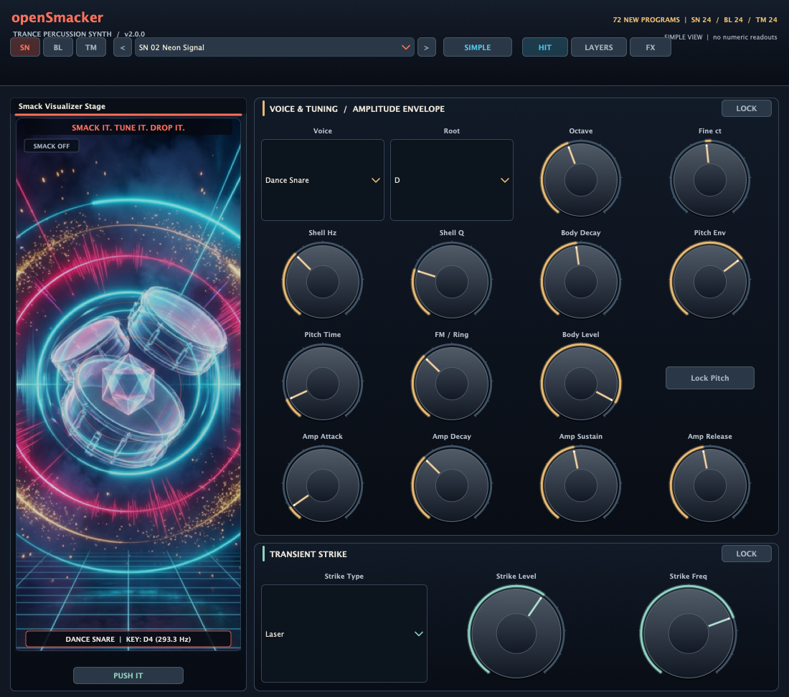
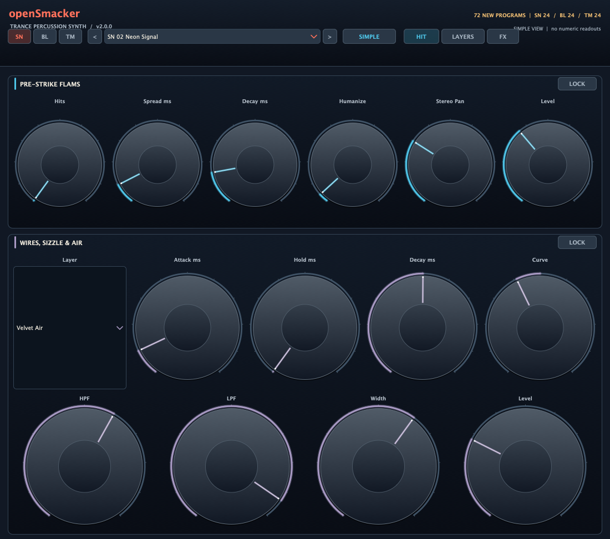
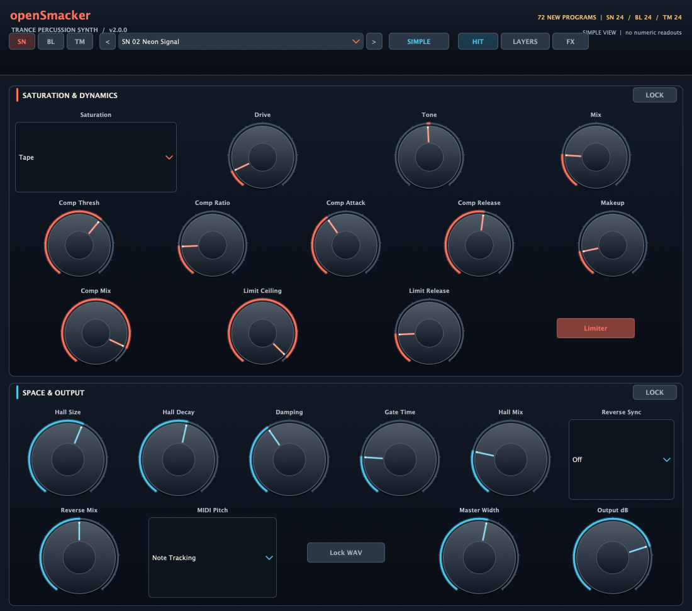

# openSmacker v2.0.0

<p align="center">
  <strong>Trance percussion, tuned for impact.</strong><br>
  A real-time snare, bell, and tom synthesizer for progressive, uplifting, tech, and psy trance.
</p>

<p align="center">
  
</p>

<p align="center">
  
</p>

<p align="center">
  
</p>

openSmacker is a C++20 instrument built with JUCE 8. Version 2 replaces the sound engine, effects, preset catalog, and editor while keeping the previous voice types, synthesis controls, MIDI mappings, program navigation, lock-in WAV workflow, and plugin formats. Its new envelopes and multi-part drum and metallic voices keep the transient and tuned body audible together for a more forceful dance and trance hit.

## Sound design

- Four voices: Dance Snare, Club Tom-Tom, FM Bell / Chime, and Pryda / Rim Smack.
- Tune every voice by root note, octave, and cents; use fixed pitch or MIDI note tracking, and retain the separate Lock Pitch option.
- Full amplitude ADSR (attack, decay, sustain, release) works with the body pitch envelope, body decay, and independent wire-layer envelope.
- Shape one to five pre-strikes with spread, decay, humanization, stereo pan, and level.
- Choose Stick, Mallet, Rimshot, or Laser transients. Add Snare Wires, White Sizzle, Velvet Air, or Metallic Ring with attack, hold, decay, curve, high/low-pass filters, level, and stereo width.
- Process hits with Tape, Tube, Hard Clip, or Wavefold saturation; compressor; brickwall limiter; gated trance-hall reverb; host-synced reverse swell; master width; and output gain.
- Use the animated stage and Push It audition button. Lock a rendered hit as WAV for repeatable stem rendering; the cache restores with the session and adapts to the host sample rate.

## Section locks

Each of the six sections has a lock button. When locked, a preset change preserves that section's values. Controls remain editable, and the lock state is stored with the session. Lock Pitch and Lock WAV remain separate features.

## New factory presets

The factory bank contains 72 new presets: 24 snares (`SN`), 24 bells and chimes (`BL`), and 24 toms (`TM`). Every preset sets all of its sound and effect values. The old factory names and definitions have been retired. Browse with the category shortcuts, preset menu, or previous/next buttons.

**Snares:** SN 01 Skyline Gate · SN 02 Neon Signal · SN 03 Aurora Snap · SN 04 Glass Horizon · SN 05 Afterglow Crack · SN 06 Silver Meridian · SN 07 Pulse Cathedral · SN 08 Voltage Bloom · SN 09 Starlight Rim · SN 10 Celestial Wire · SN 11 Chrome Lift · SN 12 Radiant Break · SN 13 Prism Impact · SN 14 Night Drive Clap · SN 15 Solar Flare · SN 16 Crystal Rush · SN 17 Echo Chamber · SN 18 Blue Hour Strike · SN 19 Harmonic Flash · SN 20 Skyline Roll · SN 21 Luminous Drop · SN 22 Electric Ribbon · SN 23 Summit Hit · SN 24 Last Light.

**Bells and chimes:** BL 01 Glass Comet · BL 02 Polar Bloom · BL 03 Silver Orbit · BL 04 Prism Arp · BL 05 Dawn Sequence · BL 06 Strobe Chime · BL 07 Moonlit Carrier · BL 08 Radiant Shard · BL 09 Crystal Current · BL 10 Aurora Bell · BL 11 Halo Cascade · BL 12 Skyline Tines · BL 13 Meteoric FM · BL 14 Velvet Beacon · BL 15 Electric Halo · BL 16 Blue Planet · BL 17 Frozen Spark · BL 18 Ascension Tone · BL 19 Neon Harmonic · BL 20 Starfield Chime · BL 21 Lucid Sequence · BL 22 Diamond Signal · BL 23 Solar Glass · BL 24 Afterlight Bell.

**Toms:** TM 01 Uplift Driver · TM 02 Deep Meridian · TM 03 Stadium Roll · TM 04 Orbital Tension · TM 05 Pulse Foundry · TM 06 Horizon Runner · TM 07 Neon Floor Tom · TM 08 Eventide Rise · TM 09 Subsurface Bloom · TM 10 Chrome Tension · TM 11 Festival Engine · TM 12 Nightfall Tom · TM 13 Solar Sequence · TM 14 Pressure Valve · TM 15 Aurora Rack · TM 16 Voltage Runner · TM 17 Cathedral Floor · TM 18 Low Orbit · TM 19 Starlane Roll · TM 20 Impact Vector · TM 21 Glass Mountain · TM 22 Breakpoint Tom · TM 23 Lightwell Rack · TM 24 Final Ascent.

## Editor

The redesigned editor is 1100 × 972 with three pages:

- **Hit:** voice, tuning, ADSR, transient, and animated stage.
- **Layers:** pre-strikes, snare wires, sizzle, and air.
- **FX:** saturation, dynamics, reverb, reverse sync, MIDI mode, output, and WAV lock.

Simple and Advanced views are retained. Simple removes numeric boxes for a clearer surface; Advanced adds exact value readouts. Every parameter remains on its page and editable in both views. Screenshots are in [docs/SCREENSHOTS.md](docs/SCREENSHOTS.md).

## MIDI and state

Note-on messages trigger hits on every MIDI channel and velocity controls the hit level. Fixed Root and Note Tracking are available. Controller behavior remains CC 7 output level, CC 74 air low-pass, CC 120/123 silence, and CC 121 reset for CC 7/74. Existing parameter IDs, saved state, cached WAV data, program count, and plugin identity are preserved. Missing section-lock data in older sessions opens unlocked.

## Formats

VST3, AU (macOS), LV2, and Standalone are built from the same source.

## Build

```sh
cmake -B build -DCMAKE_BUILD_TYPE=Release
cmake --build build --config Release --parallel
ctest --test-dir build --output-on-failure
```

See [docs/AUDIO.md](docs/AUDIO.md) for synthesis and effect notes. The project is licensed under GPL-3.0; see [LICENSE](LICENSE).
