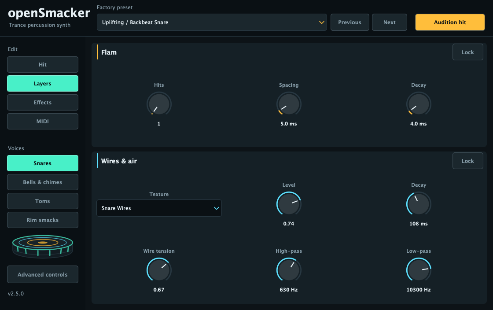

# openSmacker v2.5.1

[Install with OpenVST Manager](https://github.com/alanmarcero/alan-m-OpenVSTManager/releases/latest)

openSmacker synthesizes pitched trance percussion. Play a short backbeat, tune a tom fill to your bass line, or hold a metallic note from a MIDI keyboard.

## Find a sound

Choose **Snares**, **Bells & chimes**, **Toms**, or **Rim smacks** to jump to that voice. The **Factory preset** menu organizes all 84 presets into six dance styles: 24 Uplifting and 12 each of Rolling, Progressive, Psy, Tech, and Classic. **Previous**, **Next**, and **Audition hit** work on every page.

Try *Backbeat* for a snare with a pitched shell and tight wires, *Glass Pin* for a struck FM chime, *Floor Pocket* for a low tom, or *Rim Tick* for a short side accent. Each voice has its own overtone spacing. Harder strikes produce a brighter attack. The **Hit** page shows a preview of the dry one-shot at its root pitch. The illustrated drumhead in the sidebar pulses on the host beat, rests when playback stops, and runs on an internal clock in Standalone.

## Play one-shots or held notes

The factory sounds start in **One-shot**. Use **Body decay**, **Pitch sweep**, and **Strike Level** to fit the hit to your rhythm. On the **Layers** page, set the number and spacing of flam strikes, or adjust the wire texture, level and decay.

Choose **Hold notes** under **MIDI gate** on the Hit page to sustain the voice from a keyboard. **Attack**, **Decay**, **Sustain**, and **Release** are editable in both views. A matching note-off on the same MIDI channel starts the release, which can run up to 20 seconds. The struck FM overtones fade while the body continues to sound. **Audition hit** and the host roll play one-shots.

Select **Note Tracking** under **MIDI pitch** on the MIDI page to play melodies. **Fixed (Root)** keeps the pitch set on the Hit page. Set the velocity or aftertouch response separately for the body, wires, and transient.

## Shape and route the layers

Enable **Advanced controls** for shell resonance and FM, pitch decay, the body and transient filters, pan, wire attack and hold, and flam humanization. Lock a section to keep its values while browsing. Locked controls stay editable.

The **Hit** page includes the **Output** strip (dual-layer 3-band EQ with ±12 dB gain and smooth frequency glide, stereo width, output gain, and brickwall limiter) alongside body tuning, transient strike, and amplitude envelope.

On **Effects**, choose Tape, Tube, Hard Clip, or Wavefold saturation. Advanced controls include compression, gated reverb, a tempo-synced reverse swell, and **Lock WAV** to store a rendered hit in the project. Three additional stereo output buses carry the dry body, wires, and transient.

The MIDI page also has editable voice zones. The default ranges are 36–47 for snare, 48–59 for tom, 60–71 for bell, and 72–84 for rim. Use host-synced eighth-, sixteenth-, or thirty-second-note rolls and adjust their probability, velocity, and accent. Assign CCs to each layer. CC 7 controls output, CC 74 controls the air filter, CC 120 and 123 stop sound, and CC 121 resets controllers.

## Screenshots

## Formats and license

VST3, LV2, and Standalone are available on macOS, Windows, and Linux. AU is available on macOS. Earlier projects open as **Custom sound** with their saved parameters, original synthesis, section locks and embedded audio. Selecting a new factory program loads the new sound.

MIT License. See [LICENSE](LICENSE).
