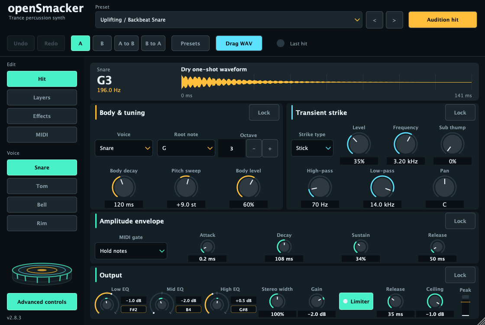
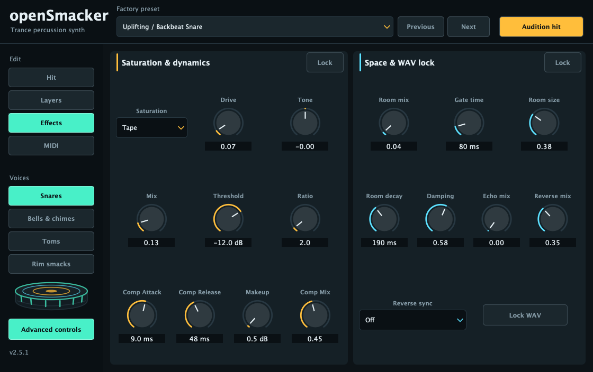

# openSmacker v2.3.0 screenshots

The native JUCE editor opens at 1120 × 704. The Hit page keeps the one-shot waveform, tuning, transient, and complete amplitude envelope together. Advanced controls expose the remaining synthesis, routing, effects, and performance settings. The drumhead in the navigation rail follows the transport on every page. Each image below is a snapshot from a real processor and editor instance. The editor test checks button and menu text widths, target bounds, and overlap in all eight views.

| Page | Main controls | Advanced controls |
| --- | --- | --- |
| Hit |  |  |
| Layers |  |  |
| Effects |  |  |
| MIDI |  |  |
