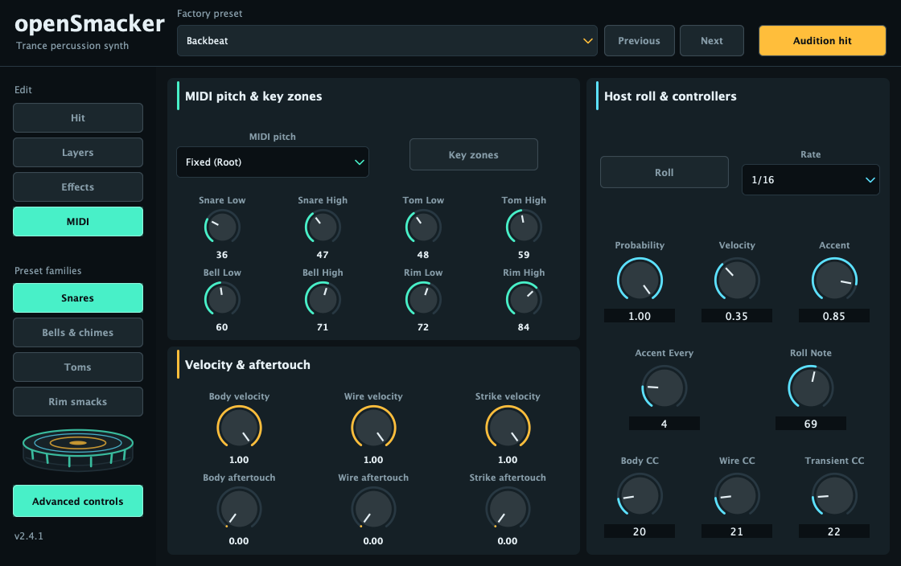

# openSmacker v2.2.2 screenshots

Captured from the built JUCE editor at its default **1440 × 1000** size. All four pages were inspected in Simple and Advanced view; labels and controls fit within their sections. Navigation uses full category, preset, and page labels. Simple keeps all parameters visible and hides only rotary numeric boxes. Advanced restores exact numeric readouts. The Hit and Layers pages show independent layer filters, pan, and wire tension.

| Page | Simple | Advanced |
| --- | --- | --- |
| Hit |  |  |
| Layers |  |  |
| Effects |  |  |
| MIDI |  |  |
