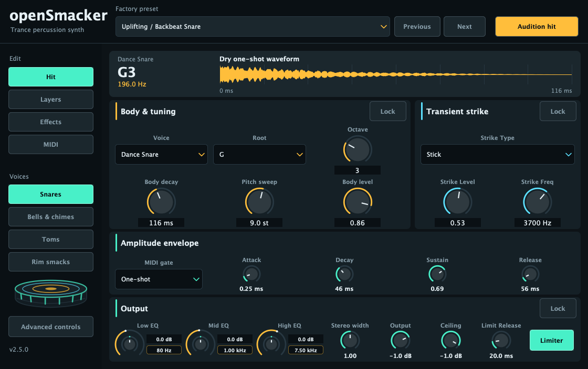
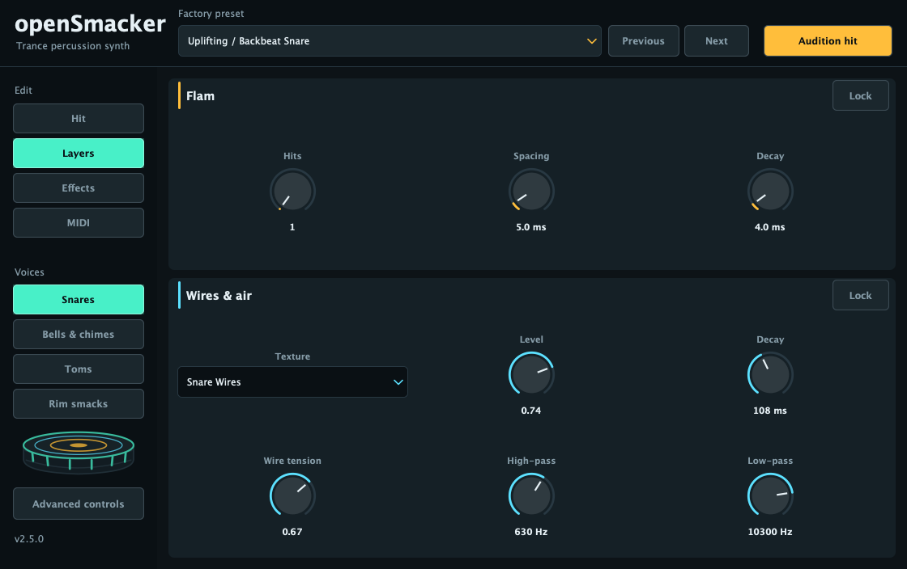
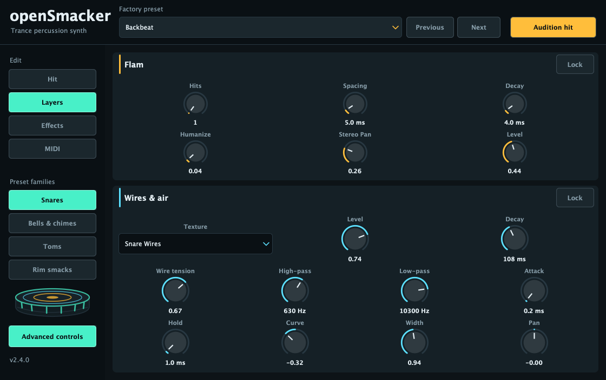
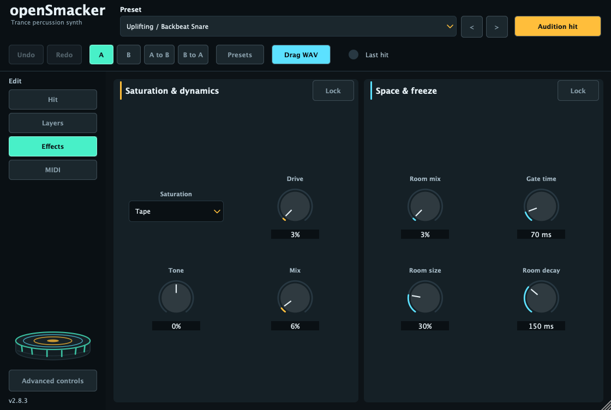
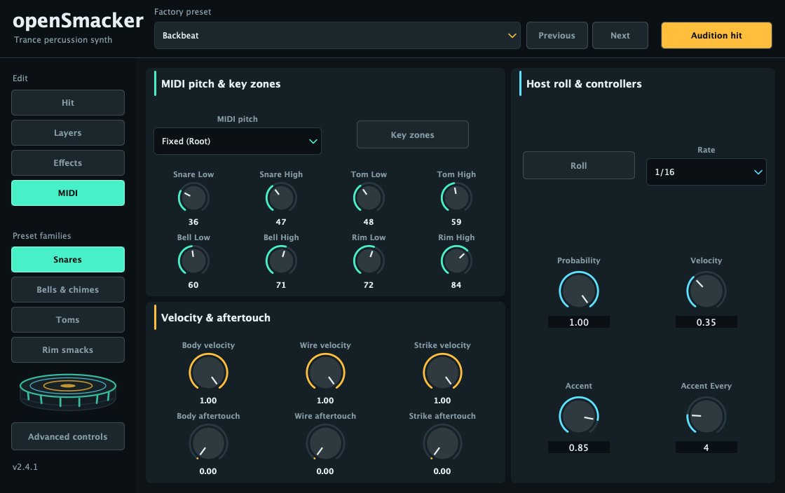

# openSmacker v2.3.0 screenshots

The native JUCE editor opens at 1120 × 752 and can be resized without a locked aspect ratio. The size is saved with the project. The Hit page keeps the one-shot waveform, tuning, transient, and complete amplitude envelope together. Advanced controls expose the remaining synthesis, routing, effects, and performance settings. The drumhead in the navigation rail follows the transport on every page. Each image below is a snapshot from a real processor and editor instance. The editor test checks button and menu text widths, target bounds, and overlap in all eight views.

| Page | Main controls | Advanced controls |
| --- | --- | --- |
| Hit |  |  |
| Layers |  |  |
| Effects |  |  |
| MIDI |  |  |


## OpenVST Manager preview

OpenVST Manager shows `docs/screenshots/preview.png` from `main` (see `screenshotPath` in its catalog), and the GitHub release body and README hero point at the same file. This is the single image to keep current. Refresh it with the main editor capture whenever the UI changes, and commit it before tagging a release:

```sh
build/opensmacker_plugin_tests '[plugin][gui]'   # writes assets/openSmacker-*.png
cp assets/openSmacker-hit.png docs/screenshots/preview.png
```
