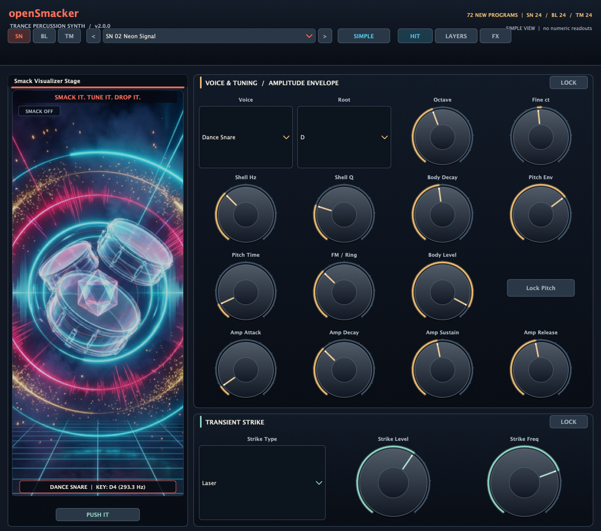
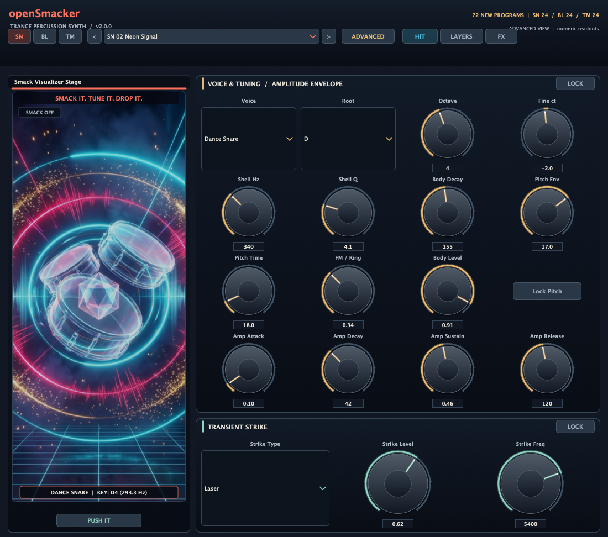
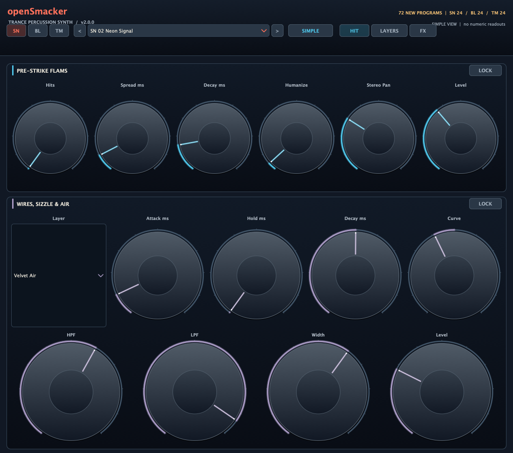
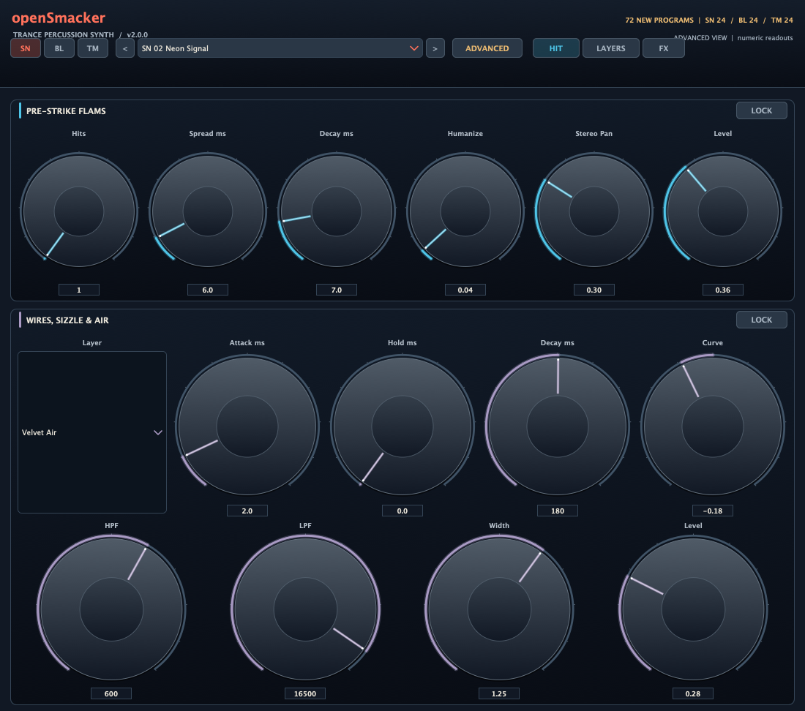
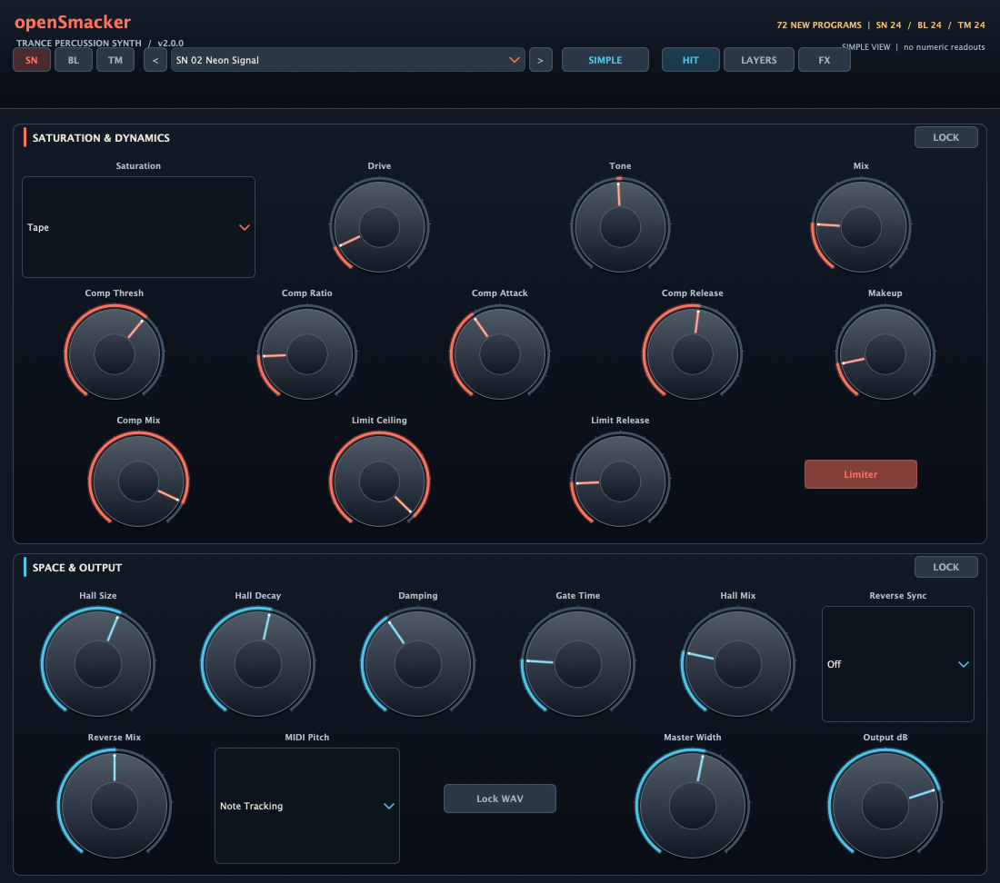
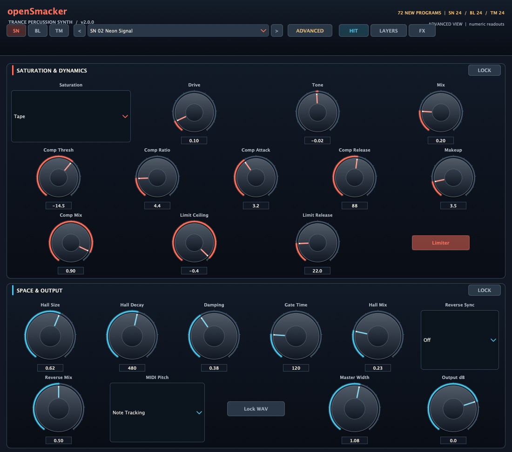

# openSmacker v2 screenshots

Captured from the built JUCE editor at its default **1100 × 972** size. All three pages were inspected in Simple and Advanced view; labels and controls fit without overlap or clipping. Simple keeps all parameters visible and hides only rotary numeric boxes. Advanced restores exact numeric readouts.

| Page | Simple | Advanced |
| --- | --- | --- |
| Hit |  |  |
| Layers |  |  |
| FX |  |  |
